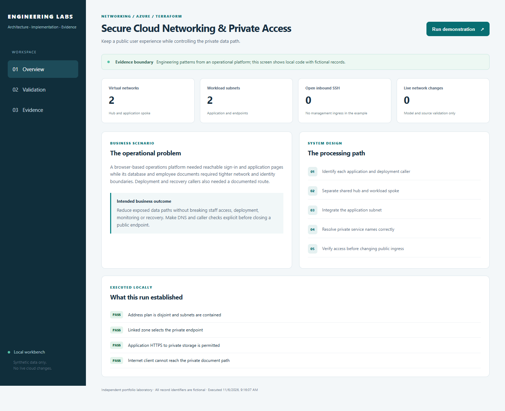
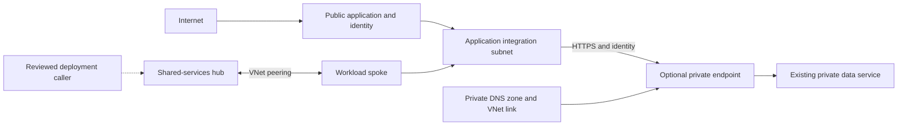
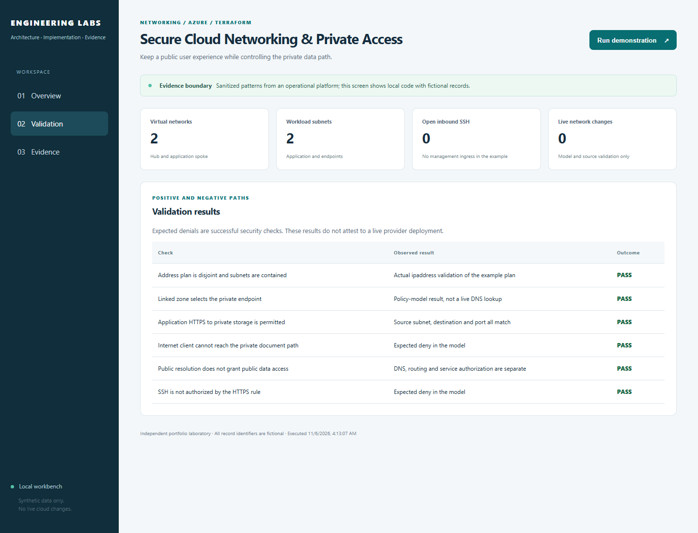

# Secure Cloud Networking & Private Access

**Let people reach the application while limiting access to its database and documents.**

[The problem](#the-business-problem) · [The solution](#the-solution) · [What was built](#what-was-built) · [Proof it works](#proof-it-works) · [Run it](#run-it-locally)



## The Business Problem

Staff and applicants need reachable sign-in and application pages. The database and employee documents need tighter access controls, and deployment and recovery tools still need a working connection. Changing a private connection or name-lookup setting can accidentally cut off one of those users or tools.

## The Solution

Separate application and private-service network areas. Check the connection path, name lookup and permissions from each type of caller before changing public access. Keep additional private connections optional until those checks are complete.

**Business outcome:** Improve data protection while preserving the access needed by staff, deployment tools, monitoring and recovery.

### Platform implementation

- Organized shared services and workload networks using parameterized Terraform modules rather than duplicating each environment.
- Used a dedicated application-integration subnet and a separate private-endpoint subnet, with resource ownership, naming and tags supplied as inputs.
- Operated a protected SQL path with separately controlled, time-limited inspection procedures and explicit restoration checks.
- Reviewed storage/vault private-path proposals against actual deployment callers, DNS resolution and cost; did not present every proposed private endpoint as deployed.

This case study draws on a workforce/operations platform I designed and implemented. Organization details and records are excluded. The public code makes selected patterns reproducible; the screenshots show a working local demonstration with fictional data. [Validation scope](docs/VALIDATION.md) separates that evidence from testing against the actual cloud service.

## Architecture



## What Was Built

| Component | Role in plain words | Implementation |
| --- | --- | --- |
| Hub and workload spoke | Separate shared connectivity from workload-owned address space. | [View code](infra/main.tf) |
| Reciprocal VNet peering | Connect the two VNets without claiming automatic routing through another connected network. | [View code](infra/main.tf) |
| Delegated application subnet | Provide the integration subnet pattern used by Functions Flex. | [View code](infra/main.tf) |
| Endpoint subnet and management NSG | Reserve private-service placement and block management ingress ports. | [View code](infra/main.tf) |
| Optional private endpoint | Target a separately managed service and linked DNS zone; default is Off. | [View code](infra/variables.tf) |
| Network policy reference | Test fictional address containment, DNS decisions and allowed/denied traffic in a model. | [View code](lab/domain.py) |

## Proof It Works

**Recorded checks:** 11 unit tests passed · 6 demonstration checks passed · 2 Terraform tests using simulated cloud responses passed.

These are dated results for this reference implementation, not live Azure/AWS deployment claims. [Test record](docs/validation-results.json) · [Evidence and limitations](docs/VALIDATION.md)

### 1. The address plan rejects overlap

The reference accepts disjoint hub/spoke ranges and rejects overlapping networks, overlapping subnets or a subnet outside its spoke.

Run from the repository root:

```bash
python -B -m unittest discover -s tests -p test_domain.py -v
```

**What to look for:** The address-plan tests accept valid ranges and reject overlap or escaped subnets.

### 2. DNS and access remain separate decisions

The model returns a private address only when both the endpoint and private-zone link are present. Public resolution does not itself grant document access.

Run from the repository root:

```bash
python -B -m lab demo
```

**What to look for:** The JSON report includes modeled DNS and allowed/denied traffic checks. It does not probe Azure.

### 3. The endpoint remains an explicit choice

Mock Terraform plans confirm no endpoint by default and reject enabling it without the required target/DNS inputs.

Run from the repository root:

```bash
terraform -chdir=infra test -filter=tests/foundation.tftest.hcl
```

**What to look for:** Both mock plans pass: an endpoint is absent by default and missing integration inputs are rejected.

### 4. Visible results

The dashboard runs the same domain code as the CLI. Desktop/mobile rendering, all three tabs, rerunning the demonstration, cross-origin write rejection and unlisted-file rejection were checked. The screenshots are captured from those runs.



Expected access denials are successful negative tests. Cloud permissions, network connectivity and provider integrations need their own acceptance evidence.

## Security Practices

- Network examples use fictional ranges and contain no existing subscription IDs or backend state.
- The endpoint is Off by default. No firewall, DNS cutover or cloud network closure is performed by this project.
- The dashboard is a policy model, not a live Azure NSG or connectivity test. Private routing still needs service authentication and caller verification.

State, saved Terraform plans, private inputs and credentials are excluded through [`.gitignore`](.gitignore). The existing validation workflow is manual-only and has no cloud deployment permission.

## Run It Locally

The [command reference](docs/COMMANDS.md) includes prerequisites, Windows equivalents, focused checks and evidence notes.

Requires Python 3.12 or newer. The default demonstration uses the Python standard library. Run inside a virtual environment:

```bash
python -m venv .venv
source .venv/bin/activate
python -m pip install -r requirements.txt
python -B -m unittest discover -s tests -v
python -B -m lab demo
python -B -m lab serve --port 8011
```

On Windows, use `.venv\Scripts\Activate.ps1` instead of the `source` command, or run `.venv\Scripts\python.exe` directly. Open [the local workbench](http://127.0.0.1:8011), choose **Run demonstration**, then review **Validation** and **Evidence**. Stop with Ctrl+C. No cloud login, employee data or paid API request is required.

## Terraform Infrastructure

Parameterized hub/spoke networking, peering configured in both directions, a delegated application subnet, a separate endpoint subnet, management-ingress restrictions and an opt-in endpoint for an existing service.

See the [Terraform code and validation steps](infra/README.md), [input example](infra/example.tfvars.example) and [mock plan tests](infra/tests). Cloud commissioning and any paid resources remain separate from the local demonstration.

Validate the infrastructure source without creating cloud resources:

```bash
cd infra
terraform init -backend=false
terraform fmt -check -recursive
terraform validate
terraform test
```

The tests use mock providers. Example inputs are placeholders, not deployment-ready values. Review the [integration boundaries and cost notes](infra/README.md) before any separate cloud commissioning.

## Scaling and Tradeoffs

Plan non-overlapping addresses before adding spokes. Keep DNS ownership, shared-service placement and deployment/recovery paths explicit. Private endpoints add cost and operating dependencies; they should follow a verified caller matrix.

See [strengths, weaknesses and tradeoffs](docs/SCALING.md) for the detailed decisions.

## Skills Demonstrated

- Azure hub-and-spoke networking
- VNet peering and subnet delegation
- NSGs and private endpoint design
- DNS and caller-path troubleshooting
- Reusable Terraform and mock plan validation

## Project Guides

| Guide | What you will find |
| --- | --- |
| [Command reference](docs/COMMANDS.md) | Copy the commands, understand their purpose and check expected results |
| [Implementation walkthrough](docs/WALKTHROUGH.md) | Follow the processing path and code |
| [Architecture](docs/ARCHITECTURE.md) | Understand service and identity boundaries |
| [Terraform](infra/README.md) | Read the resource map, input examples and integration steps |
| [Validation evidence](docs/VALIDATION.md) | See the test dates, results and limits |
| [Operations and troubleshooting](docs/OPERATIONS.md) | Diagnose failures and recover safely |
| [Security and privacy](SECURITY.md) | Review access, secrets and publication controls |
| [Scaling and tradeoffs](docs/SCALING.md) | Understand the costs of each design choice |
| [References](docs/REFERENCES.md) | See technical sources and presentation inspiration |

## Repository Map

```text
infra/               Terraform source, example inputs and mock plan tests
lab/                 Working reference implementation and loopback dashboard
tests/               Positive, negative and recovery cases
docs/                Architecture, walkthrough, evidence and operating guide
.github/workflows/   Manual-only contract validation; no cloud deployment
```

## Cost and Cleanup

The default local demo creates only temporary local state and makes no paid calls. Cloud examples are separate opt-in source and can create billable resources if an operator applies them. No automated deployment or destruction is configured. Use `git status --short --ignored` before cleanup; remove only your own `.venv` or disposable lab output. Never copy real state files, tokens or employee documents into this repository.
