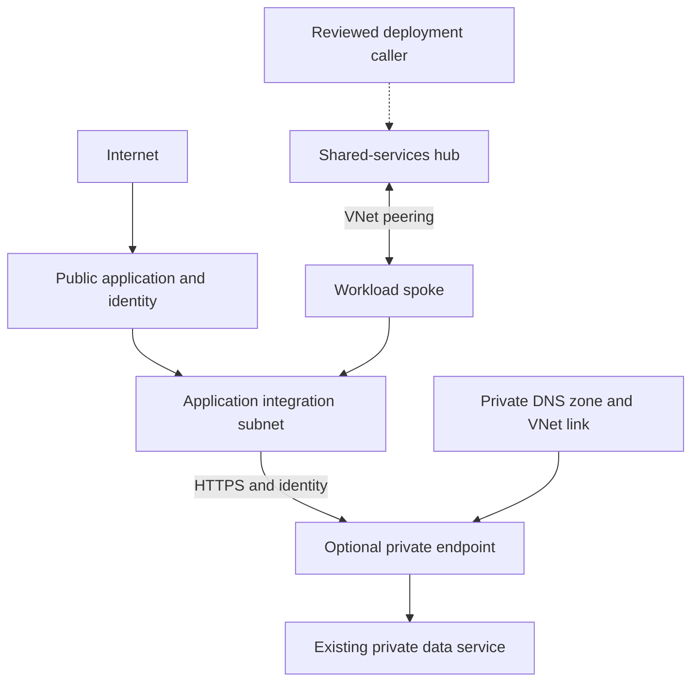

# Architecture and implementation boundaries

**Terms used here:** A private endpoint gives a supported service an address on a private network; access permissions still apply. DNS turns a service name into the network address used to reach it.

## Source-platform context

A browser-based operations platform needed reachable sign-in and application pages while its database and employee documents required tighter network and identity boundaries. Deployment and recovery callers also needed a documented route.

- Organized shared services and workload networks using parameterized Terraform modules rather than duplicating each environment.
- Used a dedicated application-integration subnet and a separate private-endpoint subnet, with resource ownership, naming and tags supplied as inputs.
- Operated a protected SQL path with separately controlled, time-limited inspection procedures and explicit restoration checks.
- Reviewed storage/vault private-path proposals against actual deployment callers, DNS resolution and cost; did not present every proposed private endpoint as deployed.

## Processing path

## Portable reference boundary

This repository keeps the decision logic small enough to inspect and run. SQLite, temporary files and modeled network decisions replace cloud-side resources where stated. No production identifiers or original employee records are included. The browser dashboard is a loopback-only demonstration, not a hosted multi-user application.

The public implementation borrows the source platform's responsibilities and failure lessons. It does not claim byte-for-byte equality with the Node.js/Azure implementation. Changes of language or backing store are explicitly reference adaptations.

## Trust boundaries

1. Treat user input, scan events and imported files as untrusted data.
2. Validate identity, resource ownership and exact source/version before changing state.
3. Keep privileged workers and deployment identities separate from business API permissions.
4. Preserve failed and unknown outcomes; do not turn absence of evidence into a success.
5. Keep secrets in a managed secret store or local environment, never in Git or screenshots.

## Before a hosted deployment

Review the caller matrix, identity permissions, durable state, concurrency, log redaction and recovery path. Run actual provider integration tests in an isolated environment. Separately review cost, data retention, DNS and rollback. The manual CI validates local contracts only and has no cloud identity or deployment permission.

## Included Terraform

Parameterized hub/spoke networking, peering configured in both directions, a delegated application subnet, a separate endpoint subnet, management-ingress restrictions and an opt-in endpoint for an existing service. See [the code map, resource inventory and integration boundaries](../infra/README.md). This public root does not provision every box in the application diagram.
