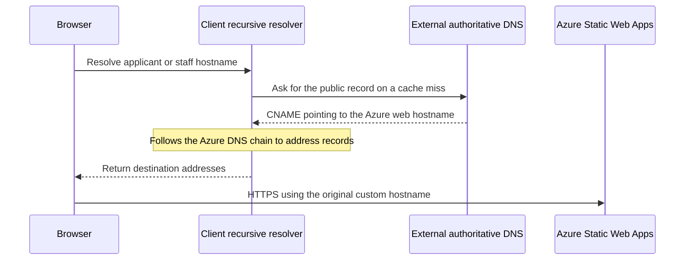
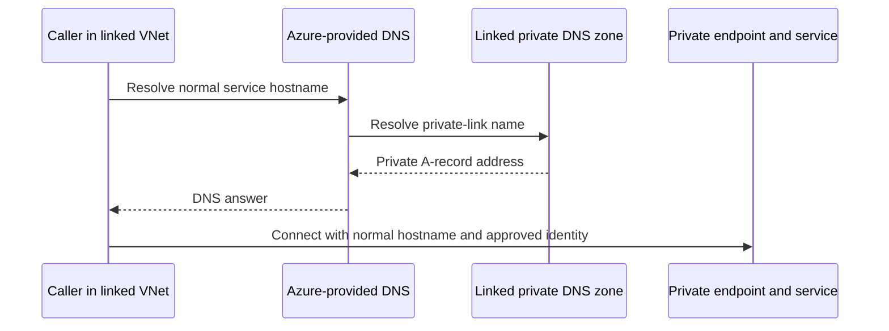

# Configure and verify Azure Private DNS

DNS turns a service name into an address. For a private endpoint, the useful result is the intended private address from the caller that needs it—not merely a successful lookup from an engineer’s laptop.

This walkthrough extends the existing private-networking project. It follows the platform’s actual zone/link/endpoint pattern, using fictional names and read-only inspection examples. It does not move the organization’s public DNS to Azure or deploy another resolver.

## The business problem

Applicants and staff need public website names that work from ordinary browsers. The application and its workers also need private names for selected database and storage services. Those two paths have different owners, callers and failure modes.

## Tools used and what they do

| Tool or component | Job | Boundary |
| --- | --- | --- |
| External public DNS provider | Serve the organization’s public records | The actual authoritative provider is external to Azure |
| Azure Private DNS | Hold service-specific private records | Not an internet-facing public website zone |
| VNet link | Let the intended network use a private zone | Does not create a private endpoint or grant data access |
| Private endpoint zone group | Associate an endpoint with its zone and manage its records | Distinct from VM automatic registration |
| Terraform | Describe the selected zone, link and endpoint association | Existing state/root ownership must be preserved |
| Azure CLI and Azure portal | Inspect records, links, endpoint state and DNS configuration | Commands below are read-only; portal configuration steps are a reviewed future-change guide |
| nslookup, dig or Resolve-DnsName | Observe the resolver’s actual answer | Run from the intended caller; the tools do not create network access |

## Start with the actual arrangement

The November 9, 2026 read-only inventory found this configuration. Public organization/resource names and private IPs are omitted from the public example.

| Layer | Observed arrangement | Evidence limit |
| --- | --- | --- |
| Public website DNS | An external provider is authoritative; applicant and staff CNAMEs point to the same production Static Web App | DNS does not perform staff authentication or proxy the application traffic |
| Production private DNS | Separate SQL and Blob zones, linked to the application VNet; one SQL and three Blob A-record sets | Record counts do not prove a successful application connection |
| Nonproduction private DNS | SQL, Blob, Queue and Relias-vault zones remain linked to its application VNet; zero A-record sets | Endpoint paths were removed in the November 6 cost pause; zone existence is not service readiness |
| VNet DNS servers | No custom DNS servers configured | The declared configuration uses Azure-provided resolution; no live caller query was performed |
| Hub subscription | No public/private DNS-zone or DNS Private Resolver resource returned | Private DNS is not currently centralized there |
| Resolver preparation | DNS Private Resolver subnets are reserved in source | A reserved subnet is not a running or commissioned resolver |

The linked zones had VM autoregistration disabled. Endpoint records are managed through endpoint zone groups rather than by registering arbitrary VMs. Production and nonproduction retain their separate zone ownership; the shared-hub alternative is a future architecture decision.

## Follow the two paths





The diagrams describe logical successful resolution paths, not fresh packet captures or a separate network request for every drawn private-zone step. A browser normally asks its configured recursive resolver, which follows the authoritative public records and returns the address; the authoritative website DNS provider is not an application proxy. Keep the normal SQL/storage service hostname in the application rather than replacing it with an IP address; this preserves the intended service/TLS name. See Microsoft’s [private endpoint DNS guidance](https://learn.microsoft.com/en-us/azure/private-link/private-endpoint-dns).

## Four-step walkthrough

1. **Choose the zone and its owner.** Match the zone to the endpoint’s service and find any existing resource/state owner. Reuse that owned zone where appropriate rather than introducing another conflicting owner.
2. **Link the intended callers.** Add the reviewed application VNet link and choose resolution without VM autoregistration for this pattern. Peering alone does not make a private zone visible to every network.
3. **Associate the endpoint and inspect its record.** Connect the existing endpoint to the reviewed zone through its DNS zone group. Check the endpoint’s approved state and resulting A record before treating the configuration as ready.
4. **Verify from the caller and check access separately.** Resolve the normal service hostname from the intended network and compare the answer with the endpoint’s actual address. Then perform the separately authorized connection and identity checks, keeping their results distinct from DNS success.

## Choose the right service-specific zone

| Service | Recommended zone in this pattern | Endpoint group |
| --- | --- | --- |
| Azure SQL Database server | `privatelink.database.windows.net` | `sqlServer` |
| Blob Storage | `privatelink.blob.core.windows.net` | `blob` |
| Storage Queues | `privatelink.queue.core.windows.net` | `queue` |
| Key Vault | `privatelink.vaultcore.azure.net` | `vault` |

These services do not share one interchangeable endpoint. Use the service-specific suffix and group; a Blob endpoint does not also provide Queue connectivity. Microsoft maintains the [service-to-zone mapping](https://learn.microsoft.com/en-us/azure/private-link/private-endpoint-dns).

## Terraform: zone, link and association

The excerpt below follows the selected SQL-module pattern. Its variables and referenced VNet/endpoint belong to the owning environment; this is documentation, not a new runnable root or permission to apply it to an adopted state.

```hcl
resource "azurerm_private_dns_zone" "sql" {
  name                = "privatelink.database.windows.net"
  resource_group_name = var.network_resource_group_name
  tags                = var.tags
}

resource "azurerm_private_dns_zone_virtual_network_link" "sql_app_vnet" {
  name                  = var.dns_link_name
  resource_group_name   = var.network_resource_group_name
  private_dns_zone_name = azurerm_private_dns_zone.sql.name
  virtual_network_id    = var.virtual_network_id
  registration_enabled  = false
  tags                  = var.tags
}
```

Inside the private endpoint resource **already owned by that root**, the association has this shape:

```hcl
private_dns_zone_group {
  name                 = var.private_dns_zone_group_name
  private_dns_zone_ids = [azurerm_private_dns_zone.sql.id]
}
```

The existing public [endpoint example](../infra/main.tf) deliberately receives `existing_private_dns_zone_id`; it does not create a competing zone. Review the owner of that zone and its VNet link before enabling the example’s default-Off endpoint.

`registration_enabled = false` controls automatic VM registration. It does not prevent the zone group from managing private endpoint records. Microsoft explains this distinction in its [VNet-link documentation](https://learn.microsoft.com/en-us/azure/dns/private-dns-virtual-network-links).

## Read-only Azure CLI inspection

Run these Bash examples only with your approved read identity. Replace the fictional names, select the exact subscription explicitly and keep raw infrastructure output private; none of these commands changes Azure resources.

```bash
SUBSCRIPTION='reviewed-subscription-name-or-id'
DNS_RG='rg-example-connectivity'
ZONE='privatelink.database.windows.net'
ENDPOINT_RG='rg-example-connectivity'
ENDPOINT_NAME='pe-example-sql'
VNET_NAME='vnet-example-app'
VNET_RG='rg-example-connectivity'

az network private-dns zone show \
  --subscription "$SUBSCRIPTION" --resource-group "$DNS_RG" \
  --name "$ZONE" --query '{name:name,recordSets:numberOfRecordSets}' -o json

az network private-dns link vnet list \
  --subscription "$SUBSCRIPTION" --resource-group "$DNS_RG" \
  --zone-name "$ZONE" \
  --query '[].{name:name,vnet:virtualNetwork.id,linkState:virtualNetworkLinkState,registration:registrationEnabled}' -o json

az network private-dns record-set a list \
  --subscription "$SUBSCRIPTION" --resource-group "$DNS_RG" \
  --zone-name "$ZONE" \
  --query '[].{name:name,ttl:ttl,addresses:aRecords[].ipv4Address}' -o json

az network private-endpoint show \
  --subscription "$SUBSCRIPTION" --resource-group "$ENDPOINT_RG" \
  --name "$ENDPOINT_NAME" \
  --query '{state:provisioningState,connections:privateLinkServiceConnections[].privateLinkServiceConnectionState.status,dns:customDnsConfigs}' -o json

az network private-endpoint dns-zone-group list \
  --subscription "$SUBSCRIPTION" --resource-group "$ENDPOINT_RG" \
  --endpoint-name "$ENDPOINT_NAME" -o json

az network vnet show \
  --subscription "$SUBSCRIPTION" --resource-group "$VNET_RG" \
  --name "$VNET_NAME" --query '{name:name,dnsServers:dhcpOptions.dnsServers}' -o json
```

**Look for:** the intended zone and VNet link, the expected record/address, the endpoint association and approved connection, and the caller’s actual DNS configuration. An empty custom-DNS-server list indicates the VNet has no custom server configured; it is not an observed query trace. The actual process can still use a NIC/OS override, application/container DNS setting or encrypted-DNS resolver, so inspect that caller before concluding which resolver it uses. A zone’s total record-set count can include SOA, so inspect A records explicitly rather than treating the total as an endpoint count.

### Compare with the endpoint’s assigned address

`customDnsConfigs` can be empty when a DNS zone group manages the endpoint’s DNS. That alone is not proof that the endpoint has no address: inspect the network interface (NIC) referenced by the selected endpoint and compare its actual IP configurations with the zone’s A record. Microsoft’s [private endpoint diagnostics](https://learn.microsoft.com/en-us/troubleshoot/azure/private-link/troubleshoot-private-endpoint-connectivity-failure) describe this distinction.

This Bash block reuses the reviewed inputs above. It reads the NIC only when the endpoint lookup succeeds and returns a nonempty ID; the returned ID already includes the selected subscription and resource scope.

```bash
if ENDPOINT_NIC_ID="$(az network private-endpoint show \
  --subscription "$SUBSCRIPTION" --resource-group "$ENDPOINT_RG" \
  --name "$ENDPOINT_NAME" --query 'networkInterfaces[0].id' -o tsv)" \
  && [ -n "$ENDPOINT_NIC_ID" ] && [ "$ENDPOINT_NIC_ID" != 'None' ]; then
  az network nic show --ids "$ENDPOINT_NIC_ID" \
    --query 'ipConfigurations[].{name:name,privateIP:privateIPAddress,version:privateIPAddressVersion}' \
    -o json
else
  printf '%s\n' 'No verified endpoint NIC reference was returned; inspect endpoint state before continuing.' >&2
  false
fi
```

**Look for:** the IP configuration that belongs to the intended service/endpoint and an exact match with its private DNS record. Multiple configurations must be assessed rather than assuming the first address is correct. A NIC read denial is a management-plane permission limit, not proof of broken DNS; retain that limit without granting broader access or changing the endpoint. See the [NIC CLI reference](https://learn.microsoft.com/en-us/cli/azure/network/nic#az-network-nic-show).

The link command projects a few fields, including link state. If fallback policy matters, inspect the complete link response using the same read-only command without `--query`; a missing policy field in that response/API version must remain unknown rather than being interpreted as enabled fallback.

### Query from the intended caller

These examples perform DNS reads only; they do not test a SQL login, Blob authorization or TCP connectivity. Use an already available, approved caller—do not start a paused VM/API simply to run them.

```bash
SERVICE_HOST='example-server.database.windows.net'
nslookup "$SERVICE_HOST"

# If dig is installed, this shows the ordinary resolver's response details.
dig "$SERVICE_HOST" A
```

PowerShell alternative:

```powershell
$serviceHost = 'example-server.database.windows.net'
Resolve-DnsName -Name $serviceHost -Type A -DnsOnly
```

**Look for:** the service’s expected name chain and private answer matching the reviewed endpoint, from the intended caller. A private answer alone does not establish that it is the correct private address, and a public laptop lookup cannot prove what an integrated worker sees. Record the caller, resolver, query time, answer and relevant cache/TTL evidence without publishing private addresses. These examples use the caller’s configured resolver; forcing an unrelated public resolver would test a different resolution path.

### Contrast with public website DNS

The actual public authoritative service is NixiHost; the public example uses reserved `example.org` names instead of the organization’s domain. The public CNAMEs point applicant and staff names to Azure Static Web Apps, while Microsoft Entra and API checks decide access to staff records.

```bash
PUBLIC_DOMAIN='example.org'
nslookup -type=NS "$PUBLIC_DOMAIN"
nslookup -type=CNAME "apply.$PUBLIC_DOMAIN"
nslookup -type=CNAME "portal.$PUBLIC_DOMAIN"
```

These are placeholders: the reserved domain is not expected to reproduce the platform’s CNAME records. The public web path is distinct from private SQL/Blob names, and no Azure public DNS zone was found in the three platform subscriptions during the dated inventory.

## Azure portal: inspect first, configure only within a reviewed change

1. Open **Private DNS zones**, select the intended subscription and zone, and inspect **Recordsets** for the exact service name and A record.
2. Inspect **Virtual network links** and the actual application VNet; verify the intended link status and autoregistration choice.
3. Open the specific **Private endpoint**, inspect its connection approval and **DNS configuration**, and compare the associated zone and endpoint address.
4. Open the caller’s **Virtual network → DNS servers** and inspect Azure-provided versus custom DNS settings.
5. For a separately reviewed configuration change, create/reuse the owned service zone, add the intended VNet link and configure the endpoint’s DNS-zone association; then inspect the actual record and test from that caller.
6. Keep Terraform-owned changes in their owning root and reconcile state after any authorized exceptional portal change; a successful portal save is not functional acceptance.

Portal labels can vary. Do not add a resolver, another zone, an IP rule or a private endpoint merely to make a screenshot green. Public CNAME editing belongs to the external DNS provider, not this Azure Private DNS blade.

## Troubleshoot by symptom

| Observation | Check next | Avoid |
| --- | --- | --- |
| Normal service name resolves publicly | Actual caller/resolver, intended VNet link, suffix and endpoint association | Assuming a successful laptop lookup proves the worker’s answer |
| NXDOMAIN / name not found | Exact record name, matching zone, endpoint existence, cache and any explicitly designed fallback behavior | Creating a conflicting public zone or hard-coding a changing public IP |
| Zone exists but has no A records | Whether endpoint paths are deliberately removed; zone group and endpoint state | Treating zone existence as a working private connection |
| VNet uses default DNS but a process gets another answer | NIC/OS, application/container or encrypted-DNS overrides and the actual resolver | Assuming VNet settings alone prove every process’s DNS behavior |
| One spoke resolves, another does not | Each caller’s VNet links or explicit forwarding design | Assuming VNet peering shares zone resolution automatically |
| Endpoint metadata has no custom DNS addresses | Inspect the endpoint’s referenced NIC and actual IP configurations | Treating an empty optional field as proof that no endpoint IP exists |
| Correct private address, connection fails | Routes, endpoint approval, NSGs, service network policy and protocol/TLS | Changing DNS to hide an unrelated connection fault |
| Connection succeeds, data is denied | Token audience, identity, RBAC and SQL/record permissions | Granting broad rights as a DNS repair |
| Answer remains old after a change | Resolver/client cache, TTL and authoritative record | Repeatedly modifying records before understanding the cached answer |
| Portal/applicant site resolves, staff access fails | Browser authentication and protected API results | Treating a public CNAME as an authorization control |
| Nonproduction has no endpoint records | The dated cost-pause record and reviewed restoration prerequisites | Recreating paid endpoints without a new operating decision |

Linked private zones can affect lookups for service names that lack a corresponding private record. Do not assume public fallback is automatic; review the actual VNet-link policy and all callers before changing it. Microsoft documents the relevant [private DNS integration scenarios](https://learn.microsoft.com/en-us/azure/private-link/private-endpoint-dns-integration).

## Strengths, limits and scaling

Service-specific zones and explicit VNet links make ownership and callers visible. Zone groups reduce manual endpoint-record management, while keeping public application names separate from private data paths.

The tradeoff is another dependency: an endpoint without correct DNS, or a linked zone without the expected record, can interrupt a caller. A centralized zone/forwarding design can help when many spokes share services, but requires an explicit owner, caller matrix, cross-subscription permissions and recovery plan; peering alone does not implement it. Avoid conflicting duplicate ownership for callers that should share one resolution view, and retain deliberate separation between isolated environments.

Azure DNS Private Resolver is an optional service for forwarding/hybrid requirements, not a prerequisite silently added here. Account for zone/query costs, any resolver cost and endpoint hourly charges separately. This guide creates no Azure resource; any future configuration or caller test needs its own cost and operating scope.

## Validation and source boundary

The November 9 read-only observation verified public NS/CNAME answers, DNS resource inventory, VNet DNS-server settings, zone links and A-record counts. It did not start a paused service, query from an integrated application, test private connectivity or perform a data operation. The zero-record nonproduction zones are consistent with the documented November 6 endpoint cost pause, not a newly diagnosed outage.

Configuration excerpts follow the maintained SQL module’s private zone/link/endpoint-group pattern and the public root’s existing-zone input. The hub-and-spoke project explains the wider [routing and DNS boundary](https://github.com/truthofsource/azure-hub-spoke-networking/blob/main/docs/ROUTING-AND-DNS.md). Original tests and screenshots retain their existing scope; this documentation addition does not claim another deployment or restore rehearsal.
